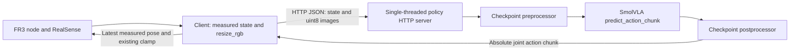

# SmolVLA server/client runtime review

Reviewed baseline: `dev` at `84ff3d82272431f20533dd8f7ac48b133a8297fd`.
Changes are confined to runtime failure handling, regression tests and this report.

## Execution path



`LeRobotBackend` reads checkpoint configuration, training dataset metadata and
saved processors. Dataset metadata supplies camera roles, square image size,
state width and fps; the model configuration supplies output width and chunk
length. The camera rename map is interpreted by the saved preprocessor.
Images become float32 BCHW tensors with CPU division by 255, then move to the
selected device. Prediction runs under `torch.inference_mode()` and the saved
postprocessor runs before a prefix of the chunk is returned.

The client asks `/info` before connecting hardware, rejects unavailable cameras
or an incompatible state width, and uses the reported fps and image size.
Capture and ZMQ operations stay in the control thread; encoding and HTTP
prediction run in one worker. Replanning starts K ticks before exhaustion;
elapsed observation time determines how many indices are skipped at replacement.
Absolute joint actions retain the existing measured-position ±0.50 rad clamp
and gripper [0,1] clamp. EE-delta legacy policies retain their existing IK path.
The robot node independently owns its 1 kHz reference filter.

## Verified normal functions

- Existing real-HTTP protocol test: image round trip, `/info`, reset,
  prediction-before-reset rejection, wrong-image-size rejection and recovery.
- Client `dry_run()` using the real HTTP server and a synthetic backend.
- Legacy `/info` fallback using real HTTP, and EE local IK output matching the
  existing server-side step exactly.
- Actual client control loop using simulated hardware: valid joint/gripper
  commands, existing clamps, chunk replacement and orderly cleanup.
- Actual LeRobot backend tensor preparation, instruction propagation, chunk
  prefix selection and warmup instruction restoration, using CPU torch and a
  synthetic model/preprocessor/postprocessor. This tests orchestration, not
  trained SmolVLA inference or processor normalization.
- Installed LeRobot 0.6.1, torch 2.11.0+cpu and `lerobot[smolvla,dataset]`:
  SmolVLA policy/configuration, robot plugin and RealSense configuration imports
  succeeded; dependency compatibility and scene grammar/rules checks passed.

## Reproduced and fixed defects

| Defect | Evidence before correction | Minimal correction | Regression coverage |
|---|---|---|---|
| Nonfinite actions could reach the robot | NaN survived both joint and gripper `np.clip`; server returned and cached a NaN chunk | Reject nonfinite state, chunks, measured poses and final commands; validate IK output | NaN/±Inf in joint and gripper; nonfinite measured/input state; bootstrap rejection |
| Empty/wrong-width chunks caused indexing failures | A later 7-column chunk after a joint-absolute bootstrap raised `IndexError` at `a[7]`; empty/1D outputs were accepted by the server | Validate every chunk before indexing or IK against the advertised width; reject malformed model output | Empty, 1D and wrong-width output; later dimension change; real HTTP error and recovery |
| Failed prediction left an older `/step` chunk usable | Cache from the preceding valid prediction survived the next malformed prediction | Clear the cache before starting a new prediction | Invalid output followed by `/step` rejection and subsequent valid recovery |
| Failure/interrupt cleanup did not request a hold | Network timeout reached cleanup with no `hold()`; the node's documented implementation continues toward its last target without a hold | Request existing `robot.hold()` before joining HTTP work; close the session and disconnect; report hold failure without masking the original error | Normal finish, network exception, hold failure and cleanup order |
| Pending prediction ignored the control run deadline | An unresolved Future blocked a 0.04 s run until externally released at approximately 0.5 s | Bound `Future.result()` by the remaining run time; existing cleanup requests hold on timeout | Unresolved Future and hold-before-worker-cleanup ordering |
| An incomplete HTTP request monopolized the server | A client advertising a longer body than it sent blocked a second `/info` request until its connection was released | Add a 60 s socket idle timeout using the standard handler's timeout support | Real incomplete-body socket, shortened timeout for testing, subsequent `/info` success |

Files changed: `apps/fr3_policy_client.py`, `apps/policy_server.py`,
`tests/gui/test_policy_safety.py`, and `tests/gui/run_all.sh`.
The first failure-injection run had 21 failures and 3 passes; the separate
deadline reproduction failed before its correction. The final focused suite
has 32 passing tests. The new test file is also registered in the GUI runner.

The first post-change GUI runner returned exit 1: `test_diversity_cloud` timed
out in its approximately six-second recommendation-worker wait and aborted.
Policy tests passed in that run. Re-running the complete diversity test in
isolation with `OPENBLAS_NUM_THREADS=1 OMP_NUM_THREADS=1 MKL_NUM_THREADS=1`
passed all eight groups. This suggests a timing/resource-sensitive failure;
it does not establish that the recommendation worker is free of defects.
No recommendation code or test deadline was changed.
The full runner repeated with those three environment overrides then returned
exit 0: 78 OK wrapper results, zero FAIL results. Its policy safety file executed
all 32 pytest cases. Internally skipped real-data sections remain unverified,
as listed below; the initial timeout is retained as an unresolved intermittent
test risk rather than erased by the passing repeat.

## Design concerns retained for review

- When a replacement chunk is already entirely expired, the client explicitly
  executes its last action. `--lead-ticks` at or beyond the effective horizon can
  also produce zero/negative nominal replan intervals. These behaviors need an
  agreed policy for stale predictions and valid timing parameters; the scheduler
  was not replaced or retuned.
- `LeRobotBackend.info()` declares joint-absolute actions for every LeRobot
  checkpoint. A compatible width alone does not prove the training labels have
  that convention. Validate the selected checkpoint's action labels before
  deployment; any action-space change needs review.
- HTTP requests use a 60 s requests timeout, which bounds socket inactivity,
  not total wall time. Startup, `--lead-ticks 0` synchronous prediction, and
  worker joining can still wait on a slow request. The Future deadline now lets
  an active control loop request hold before joining a delayed worker, but does
  not forcibly cancel an executing HTTP call. A peer trickling data can extend
  that call; true cancellation requires a separately reviewed transport/lifecycle
  change. The server timeout likewise bounds idle periods, not model inference
  or total request duration.
- Hold is a request to the robot node, not an independently verified physical
  emergency stop. If ZMQ/the node is unavailable it can fail; the failure is
  reported and cleanup continues. Physical stopping must still be verified on
  the target station.
- Client hardware connection occurs before its main cleanup block; partial
  camera-connection failure can leave resources initialized. No physical
  connection-failure claim is made here. Exercise failure paths on the station
  before changing the shared robot/camera lifecycle.
- The server retains per-prediction timing lists; long-running memory behavior
  and production latency under shared GPU load have not been measured.

## Limits and remaining model checks

No user-selected trained checkpoint, evaluation dataset or remote policy server
was supplied. This cloud machine has CPU torch and no usable CUDA device.
Trained SmolVLA weight loading, tokenizer/model execution, checkpoint processor
normalization/renaming, server-versus-offline parity, real network inference
latency, camera crop equivalence, physical motion and stopping remain unverified.
Documentation of previous lab measurements is not evidence of this run.

On the intended GPU host, use the unchanged commands documented in
`docs/policy-server.md`: start the selected checkpoint with `--seed`, run
`scripts/check/check_policy_server.py --parity --parity-tol 0` with the matching
evaluation data, then run the client's `--dry-run`. Choose lead ticks only after
measuring round-trip time. Actual station verification requires cameras, FR3,
and the separate GIL-patched pylibfranka interpreter. No dataset, checkpoint,
training configuration, normalization convention, model architecture, protocol,
control frequency or safety limit was changed.

## Re-running checks

From `/workspace/manipulation-stack`:

```bash
.venv/bin/python -m pytest tests/gui/test_policy_safety.py -q
bash tests/gui/run_all.sh /workspace/manipulation-stack/.venv/bin/python
# Reduce numerical-library contention on a small cloud CPU allocation:
OPENBLAS_NUM_THREADS=1 OMP_NUM_THREADS=1 MKL_NUM_THREADS=1 \
  bash tests/gui/run_all.sh /workspace/manipulation-stack/.venv/bin/python
.venv/bin/python -m mstack.scene.instruction_grammar
.venv/bin/python -m mstack.scene.scene_rules
```

The GUI runner's wrapper reports OK when a script exits zero even if assertions
were internally skipped. `test_convert_frames` and `test_c5_consumers` require
the absent lab `scene_023.hdf5` and skip their real-data checks;
`test_frame_table` skips its real-data section but runs synthetic assertions.
`test_depth17`'s obsolete converter import skips one section in the normal
runner; the separately verified PYTHONPATH override documented in the cloud
startup instructions exercises all seven depth checks without source changes.
